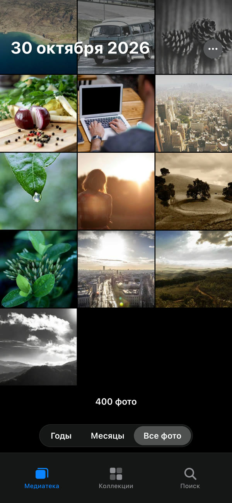
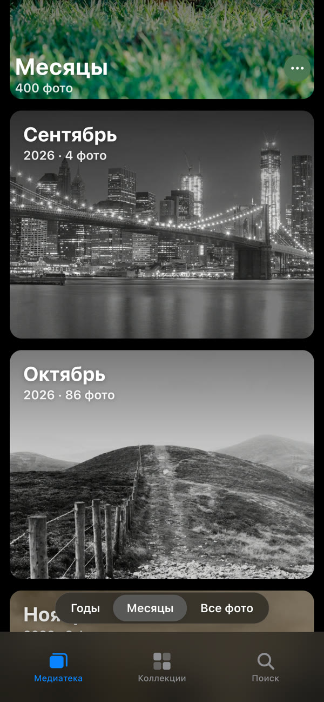
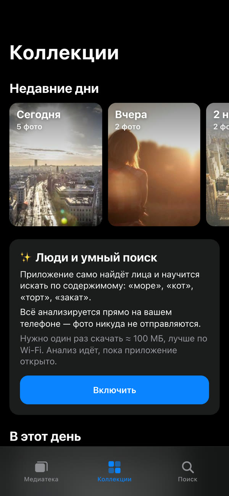
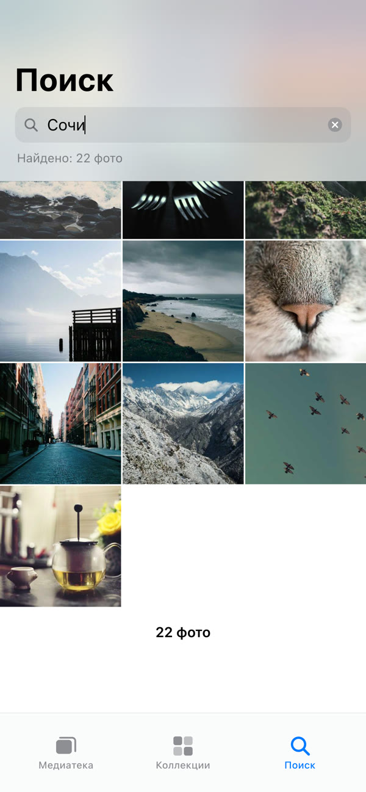
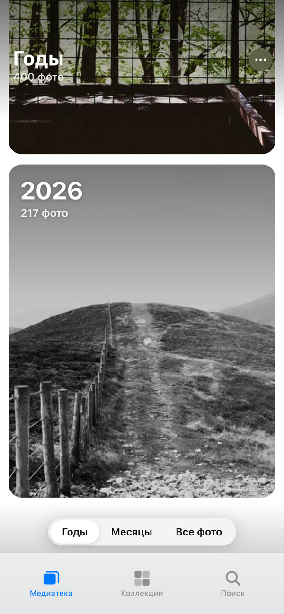

# Фото с Яндекс Диска — Telegram Mini App

Галерея в стиле «Фото» на iPhone для снимков с Яндекс Диска. Работает полностью бесплатно:
статичный сайт на GitHub Pages + REST API Яндекс Диска прямо из браузера, без своего сервера.

<p align="center">
  
  
  
</p>
<p align="center">
  
  
  
</p>
<p align="center"><sub>На скриншотах — тестовая медиатека со свободными снимками с <a href="https://unsplash.com">Unsplash</a> (через <a href="https://picsum.photos">picsum.photos</a>).</sub></p>

- Лента «Все фото», свежие снимки внизу. Щипком меняется число колонок: 1, 3, 5 или 9.
  При быстрой прокрутке у правого края появляется ползунок, как на iPhone.
- Вкладки «Годы» и «Месяцы» с обложками, «Коллекции» (недавние дни, «В этот день», поездки, альбомы-папки,
  избранное) и поиск по дате, папке и имени файла. Из альбома можно вернуться свайпом вправо.
- Сначала грузятся миниатюры (они кэшируются на устройстве), а при открытии фото — большое превью (1280 px).
  Соседние фото подгружаются заранее.
- «Поделиться» открывает системное меню телефона с фото: отправить или сохранить в галерею.
  Оригинал в полном качестве сохраняется в «Файлы» кнопкой на панели ⓘ.
- Тап по фото прячет панели, фон становится чёрным. Свайп вниз закрывает фото, двойной тап увеличивает.
- Тёмная и светлая тема — по настройке телефона.
- Токен хранится в Telegram CloudStorage вашего аккаунта, в коде его нет. Доступ к Диску только на чтение.

## Как подключаются пользователи

Им ничего не нужно настраивать. Человек открывает ссылку `https://t.me/<бот>?startapp`,
нажимает **«Войти через Яндекс»**, входит в свой аккаунт Яндекса и нажимает «Разрешить».
После этого он возвращается в приложение и сразу видит свои фото. Токен сохраняется
в облаке Telegram этого пользователя, владелец бота его не видит. Через год, когда токен
истечёт, приложение само предложит войти снова.

## 1. Зарегистрировать приложение в Яндексе (один раз, владельцу)

1. Откройте https://oauth.yandex.ru/client/new и выберите платформу «Веб-сервисы».
2. Redirect URI (каждый адрес отдельной строкой):
   - `https://wickedslim.github.io/photos/` — сюда Яндекс возвращает пользователя после входа;
   - `https://oauth.yandex.ru/verification_code` — для запасного входа по токену;
   - `http://localhost:5173/` — для локальной разработки.
3. В доступах выберите «Яндекс Диск REST API» → **«Чтение всего Диска»** (`cloud_api:disk.read`).
4. Сохраните приложение и скопируйте **ClientID**. Он не секретный.
5. Пропишите ClientID в сборку и пересоберите сайт:
   ```bash
   gh variable set YANDEX_CLIENT_ID -R wickedslim/photos --body "<ClientID>"
   gh workflow run deploy.yml -R wickedslim/photos
   ```

## 2. Сайт на GitHub Pages

Сайт уже опубликован: https://wickedslim.github.io/photos/. Каждый push в `main` пересобирает его
(workflow `.github/workflows/deploy.yml`, в настройках Pages выбран источник «GitHub Actions»).

## 3. Бот в Telegram (один раз, владельцу)

1. В @BotFather: `/newbot`, затем задайте имя и username бота.
2. `/mybots` → бот → **Bot Settings → Configure Mini App → Enable Mini App**,
   адрес `https://wickedslim.github.io/photos/`.
   После этого в профиле бота появится кнопка «Открыть», а ссылка `https://t.me/<бот>?startapp`
   будет сразу запускать приложение.
3. **Menu Button** → тот же адрес, тогда кнопка появится и рядом с полем ввода в чате.
4. `/setdescription`: например, «Ваши фото с Яндекс Диска в удобной галерее. Нажмите „Открыть“».

Своему боту сервер не нужен: он ничего не отвечает, а только открывает приложение.

## Люди и умный поиск (включается пользователем)

В «Коллекциях» есть кнопка «Включить». После неё приложение анализирует фото **прямо на телефоне**:
- **поиск по содержимому:** «море», «собака», «торт». Это CLIP ViT-B/32 для картинок и многоязычная версия CLIP
  для русского текста (модели `Xenova/clip-vit-base-patch32` и `aurantium/clip-ViT-B-32-multilingual-v1`
  с Hugging Face, ≈ 89 МБ + 136 МБ; текстовая модель скачивается только при первом поиске по смыслу);
- **«Люди»:** лица находит библиотека Human (модели ≈ 9 МБ в `public/models/human`). Похожие лица
  группируются (порог 0.64), карточку можно назвать. Если дать двум карточкам одно имя, они объединятся.
  По имени человека работает поиск.

Анализ идёт в фоне, пока приложение открыто, и продолжается с места остановки. Результаты и имена людей
хранятся только на этом устройстве (IndexedDB и localStorage). Фото никуда не отправляются.

## Локальная разработка

```bash
npm install
npm run dev
```

Тестовая медиатека без входа в Яндекс (только в режиме разработки, в рабочую сборку не попадает):
http://localhost:5173/?mock — на ней сняты скриншоты выше.


## Как это устроено

| Файл | Что делает |
|---|---|
| `src/api.js` | Клиент REST API Яндекс Диска |
| `src/loader.js` | Очередь загрузки превью: параллельность, отмена, LRU в памяти |
| `src/store.js` | Индекс фото в IndexedDB, превью в Cache Storage |
| `src/library.js` | Медиатека: виртуальная сетка, «Годы», «Месяцы» |
| `src/viewer.js` | Просмотрщик на PhotoSwipe |
| `src/screens.js` | Экран подключения, настройки, тосты |
| `src/tg.js` | Telegram WebApp: тема, CloudStorage, кнопка «Назад», полноэкранный режим |

Список всех фото загружается один раз и кэшируется. При каждом открытии подтягиваются
недавно загруженные снимки, а раз в сутки список перечитывается целиком (так находятся удалённые).
В настройках можно ограничить галерею одной папкой, например `/Фотокамера`.
